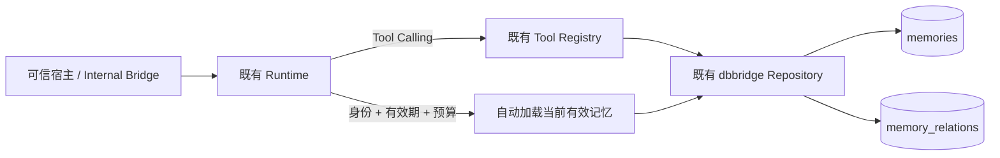

# Memory System V0.2

本版在现有 Runtime、Tool Registry、Repository、Internal Bridge 和 PostgreSQL 上增量实现。采集记录、DWS 消息和日程仍属于业务存储，本次没有移入 Memory。

## 新旧架构

| 项目 | V0.1 | V0.2 |
|---|---|---|
| 主存储 | `agent_memories` | `memories`；旧表作为迁移存档保留 |
| 归属 | 用户 + Agent 私有 | 用户 PUB、Agent PRI、Workflow PRI |
| 属性 | category、priority | BASE/TEMP + 独立 PERSONAL，保留旧 metadata |
| 组织 | 平铺 | L0–L3 + 可空父记忆，可跳层，不要求完整树 |
| 关联 | 无 | `memory_relations` 有向直接关联，与父子组织分离 |
| 自动上下文 | 当前 Agent 的记忆 | 当前用户 PUB + 当前 Agent PRI + 当前 Workflow PRI，限当前有效 |
| 主动工具 | 6 个 CRUD/检索工具 | 8 个记忆工具，含关联创建和查询，memory_list 保留为搜索别名 |



## 数据表与迁移

完整 DDL：[`memory_schema.go`](../../backend/internal/dbbridge/memory_schema.go)；查询与权限实现：[`memory.go`](../../backend/internal/dbbridge/memory.go)。现有迁移账本新增 **V9**，V1–V8 内容不变。启动时仍由 App 显式调用 `dbbridge.Migrate`，迁移和账本在同一事务、全局 advisory lock 中提交，重复启动不重复导入。

`memories` 包括 ID、用户、visibility、Agent/Workflow 可空归属、memory_type、is_personal、level、parent_memory_id、title/content、structured_content JSONB object、source_refs JSONB array、valid_from/until、status、旧 category/priority 和创建/更新时间。

数据库 CHECK 保证 PUB 两个私有归属均空，PRI 恰有一个私有归属；合法类型/层级/状态，合法有效区间。所有归属、父记忆和关联端点使用同用户复合外键。父层级必须低于子层级；不要求 L0 是所有领域的根，不要求相邻层级。父节点必须在子节点归属中可见：PUB 父，或同 Agent/Workflow 的 PRI 父。父归属/层级变更也检查已有子节点，避免隐藏父节点或形成环。Repository 按用户串行化记忆写入；数据库 trigger 进一步校验父子关系。

索引覆盖用户/visibility、Agent、Workflow、层级+类型、状态+有效期、父 ID、关联目标。关联的 `(用户,source,target,type)` 唯一；同一方向的相同类型不允许重复（description 不改变关系身份）。支持 RELATED_TO、ALIAS_OF、BELONGS_TO、DERIVED_FROM、ROUTES_TO、SUPERSEDES；均按有向关系存储，包括 RELATED_TO。

删除记忆会级联删除关联，并将子记忆的 parent_memory_id 设为 NULL。用户、Agent 或 Workflow 删除沿归属外键级联；PUB 没有 Agent 归属，不因创建 Agent 删除而删除。关系记录的创建 Agent 删除时，该 Agent 创建的关系也删除；端点记忆本身不因此删除。

旧 `agent_memories` 每行按原 `owner_user_id + agent_id` 迁入 Agent PRI；**保留 memory_id、title/content、category、priority、created_at/updated_at**。返回 JSON 的旧 agent_id 字段调整为 owner_agent_id，新增 owner_workflow_id；对应 Go Memory.AgentID 字段保留以减小调用方变更。Scope 新增仅内部使用的 WorkflowID，Go 调用方使用具名字段构造。旧结构没有稳定性、层级和个人属性，采用保守默认 BASE/L1/is_personal=false，status=active，不推断 PUB、Workflow、课程事实或有效期。无无法确定的归属：旧表已有同用户 Agent 外键。旧表不再作为运行时读写来源，保留用于审计/比对；上线后的新写入只在新版主表。不要将旧存档重新导入已运行的 V9，避免复活已删除或旧版本内容。迁移失败整体回滚，不删除旧数据。降级需要专门的数据回迁方案，不能直接运行旧二进制覆盖新记忆。

## 权限矩阵

以下均先要求用户未禁用、Agent 属于当前用户；Workflow 上下文额外校验同用户且未归档。

| 目标 | 同用户当前 Agent | 同用户其他 Agent | 其他用户 |
|---|---|---|---|
| 用户 PUB | 可访问 | 可访问 | 不可访问 |
| 当前 Agent PRI | 可访问 | 不可访问 | 不可访问 |
| 当前 Workflow PRI | 绑定该 Workflow 时可访问 | 绑定同一 Workflow 时可访问 | 不可访问 |
| 其他 Workflow PRI | 不可访问 | 不可访问 | 不可访问 |

表中的“可访问”是身份范围。工具还必须在 Agent 的 enabled_tools 中，读取/检索/关联查询需要 `memory.read`，写入/修改/删除/建关联需要 `memory.write`。PUB 的授权模型是同用户共享；本版没有额外逐条 ACL，也没有跨 Workflow 继承。自动加载沿用原 Runtime 行为，依据身份范围自动注入，不要求显式启用 memory_get；工具权限独立控制主动读取和写入。限制 MemoryBytes 可减少或禁用实际注入内容。

模型不能提交 owner_user_id。owner_agent_id 只能为当前 Agent；owner_workflow_id 只能等于当前可信执行 Workflow。修改前先检查原记忆权限，再验证新归属；不能先把其他 Agent 私有记忆“改为自己”再读取。转 PUB 应清空旧 owner_agent_id/owner_workflow_id；转另一合法归属也须显式清空旧归属字段。关联建立时验证双方访问权限；查询时对双方再次过滤，不能通过公共记忆的边暴露其他 Agent/Workflow 的私有 ID。

记忆的 parent_memory_id 是组织路径，relation 是语义关联，两者没有自动等价或权限继承。

## Workflow 执行上下文

`RunRequest.Input`、Trigger=WORKFLOW_EVENT、工具里的 owner_workflow_id、agent_dispatch.context 都不能授权 Workflow 身份。宿主在可信内部入口绑定：

```go
ctx = framework.WorkflowContext(ctx, trustedOwnerID, workflowID)
result, err := service.Run(ctx, trustedOwnerID, framework.RunRequest{
    AgentID: agentID, Trigger: framework.WorkflowEvent,
    Input: json.RawMessage(`{"text":"数分第三次作业延期"}`),
})
```

Runtime 再验证 Workflow 的归属与状态，将 WorkflowID 写入 ExecutionContext.Scope 和运行记录，并向模型提供由宿主生成的当前 Agent/Workflow 身份。A→B 的既有 Internal Bridge 调度会继承此 Workflow 身份，同时改用 B 自己的 Agent PRI。JSON 不能伪造该 context key；内部调用不经过 HTTP。本版仍没有 Workflow 执行引擎，以上是既有 Runner 的上下文绑定入口，不声称能执行 Workflow 定义。

管理员后台是显式运维入口，可用 `workflow_id` 查询参数选择同用户 Workflow；后端验证后绑定上下文。该参数不在面向模型的 RunRequest 或记忆工具中提供授权能力。

## 工具 JSON Schema

完整的输入、输出、权限和超时见 [`memory-tool-schemas.json`](memory-tool-schemas.json)，由实际注册表生成；全工具目录见 [`tool-catalog.json`](tool-catalog.json)。所有输入拒绝额外字段。各工具：

| 工具 | 关键行为 |
|---|---|
| memory_create | 归属、BASE/TEMP、PERSONAL、L0–L3、父 ID、内容、结构化内容、来源、有效期、状态、priority；旧参数只传 title/content 时默认当前 Agent PRI、BASE、L1、active |
| memory_search | query、归属、类型、PERSONAL、层级、状态、父 ID、validity、limit；默认 active/current，最多100条 |
| memory_list | memory_search 兼容别名，语义相同 |
| memory_get | 按 ID 执行归属检查；可显式读取历史记录，调用者须查看 status 与有效期 |
| memory_update | 按显式字段 PATCH；省略字段保留，null 清除可空字段；变更归属重新验证 |
| memory_delete | 硬删除，级联关联、解除子记忆 parent 引用 |
| memory_create_relation | 验证两个端点并建立有向关系；重复关系明确报错 |
| memory_get_relations | 指定 ID、relation_type、incoming/outgoing/both、limit，depth 只支持1 |

memory_create 的 visibility/type/level 可省略以兼容旧调用，但新 Agent 应显式选择适当归属。structured_content 限 JSON 对象，source_refs 限数组；时间接受 RFC3339，valid_until 必须晚于 valid_from。TEMP 可以设置失效时间；未设置则无自动过期，不能自行假定过期日。PERSONAL 与 BASE/TEMP 独立组合。state 使用 active/archived/invalid，validity 使用 current/expired/future/all；默认搜索不会把历史内容当成有效事实，history 查询须显式指定。

有效期过滤适用于 BASE 和 TEMP：`valid_from IS NULL OR valid_from <= now()`，且 `valid_until IS NULL OR valid_until > now()`。失效边界不包含在当前范围内。过期行保留，memory_get 可读完整历史元数据；关联查询只返回边，沿边读取也必须检查有效期。本版不自动将过期 status 改成 archived，不启动隐式清理循环。

## Runtime 自动加载与主动检索

每次 Run 按可信 Scope 查询当前用户 PUB、当前 Agent PRI，以及当前 Workflow PRI。默认仅 active、当前有效；候选最多1000，按 priority DESC、created_at ASC、memory_id ASC 排序。在 MemoryBytes 内挑选可完整放入的记录，超大记录跳过；不截断原始内容，不删除数据库记忆。Runtime 在注入前再次判断 status/有效期，防止存储适配器误返回过期数据。注入标记为不可信事实上下文，不能覆盖系统指令或扩大工具权限。

默认 MemoryBytes=16KiB，不保证一次注入全部记忆。Runtime 的系统提示指导模型在信息不足或有歧义时主动检索、读取和查关联，证据充分时避免重复查询；未验证推断优先 PRI，经确认且跨 Agent 有用的信息可存 PUB。后端只验证归属、权限和数据完整性，不自动判断每条事实是否“已确认”。没有启用相应工具的 Agent 不会被自动扩大权限；例如现有 Trigger Agent 的零工具配置保持原样。

一次主动联想调用示例（ID 来自上一步结果）：

```json
{"tool":"memory_search","arguments":{"query":"数分","visibility":"PUB","limit":10}}
{"tool":"memory_get","arguments":{"memory_id":"course-memory-id"}}
{"tool":"memory_get_relations","arguments":{"memory_id":"course-memory-id","relation_type":"ROUTES_TO","direction":"outgoing","depth":1,"limit":20}}
{"tool":"memory_get","arguments":{"memory_id":"route-memory-id"}}
```

新增关联：

```json
{"source_memory_id":"course-memory-id","target_memory_id":"route-memory-id","relation_type":"ROUTES_TO","description":"经确认的课程路由证据"}
```

创建可共享的个人基础记忆：

```json
{"visibility":"PUB","memory_type":"BASE","is_personal":true,"level":"L0","title":"提醒偏好","content":"用户确认：提前两天提醒","structured_content":{"advance_days":2},"source_refs":[{"kind":"user_confirmation"}]}
```

把自己的私有记忆提升为 PUB：

```json
{"memory_id":"own-memory-id","visibility":"PUB","owner_agent_id":null,"owner_workflow_id":null}
```

## 验证与限制

`backend/internal/dbbridge/memory_test.go` 使用独立 PostgreSQL 随机 schema + 真实 Runtime/Tool Registry + Mock Model。覆盖两用户、Filter/Worker/Learner、两个 Workflow；48个独立 Runtime 工具调用，另有六轮模型/五次工具的连续主动关联检索、通过 Internal Bridge 的 Workflow 调度继承、伪造 Workflow 上下文拒绝、旧数据迁移、数据库约束、失效过滤和删除清理。后台 API 另测 Workflow 参数、跨用户拒绝和旧编辑器 PATCH 不重置新分类。其他 Runtime、工具与业务模块回归共同运行。

可重复运行：

```sh
cd agent/framework
go test -race ./...
go vet ./...
go run ./cmd/tool-catalog > tool-catalog.json
cd ../../backend
TEST_DATABASE_URL=postgres://test_user@127.0.0.1:55437/postgres?sslmode=disable go test ./...
TEST_DATABASE_URL=postgres://test_user@127.0.0.1:55437/postgres?sslmode=disable go test -race ./internal/dbbridge ./internal/agent ./internal/agentadmin
go vet ./...
```

TEST_DATABASE_URL 必须为独立测试库；每个测试创建并删除随机 schema，不读取生产 DATABASE_URL。浏览器脚本 `backend/scripts/memory_v02_ui.cjs` 使用临时用户和实例，结束清理；配置 DEMO_ORIGIN、BOOTSTRAP_ADMIN_USERNAME/PASSWORD、PLAYWRIGHT_MODULE，支持 MEMORY_SCREENSHOT_DIR。不会修改既有用户记忆或模型密钥。

本版没有向量检索、无限图遍历、关联权重学习、自动摘要合并、跨用户共享或跨 Workflow 同步。关键词搜索是受限文本包含查询，不是语义检索。完整工具输出仍受 ToolResultBytes 限制，大内容应缩小 limit 后逐条读取。没有新增日程或 DWS 数据查询工具。

### 本地验收记录

2026-11-05（Asia/Shanghai）已完成独立 PostgreSQL 的全后端测试、框架与关键后端包 race 检查，以及两个 Go 模块的 vet。新增 Runtime/Bridge/PostgreSQL 验收和后台 API 验收均通过。浏览器脚本在隔离 demo 和更新后的本地2610服务上分别通过8组批量用例，页面 JS 错误为0，覆盖桌面和手机视口。截图位于 `.build/memory-v02-desktop.png` 与 `.build/memory-v02-mobile.png`，浏览器用例创建的临时用户结束后删除。

当前本地服务已由 V8 升到 V9；只读审计报告 legacy_memories=1、current_memories=1、unchanged_legacy_copies=1，证明这1条旧记忆按原ID/归属/内容/元数据/时间完整保留，无法自动确定归属的记录为0。已有 Agent 定义在更新前后逐项比对一致，未自动授予新工具。实际模型对新增关联能力的行为质量未在本次消耗外部额度验证；本次运行链验收使用确定性的 Mock Model。

可在显式设置 `MEMORY_V02_LIVE_AUDIT=1` 后，使用服务配置运行 `go test ./internal/dbbridge -run '^TestMemoryV02LiveMigrationAudit$' -v -count=1` 做只读迁移统计；不会迁移、修改或输出记忆正文。后续已编辑或删除的旧记忆会导致 unchanged_legacy_copies 少于原始行数，不代表迁移丢失。
