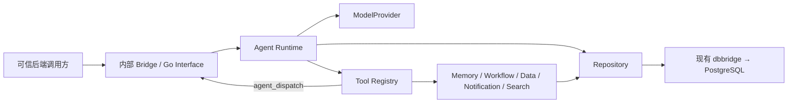

# Academic Agent Framework — 第一阶段

通用 Go Agent Framework，主体位于 `agent/framework`。不包含 Filter、Worker、Learner 业务实现、HTTP 路由或 Workflow 执行引擎。框架作为独立 Go module，通过接口接入现有后端；`backend/internal/agent` 适配已有 `bridge.Port`，全部 PostgreSQL 访问仍由 `backend/internal/dbbridge` 实现。

本阶段已实现实例配置 CRUD、受限多轮 Tool Calling、18 个内置工具、每 Agent 私有记忆、同步跨 Agent 调度、Workflow 定义和版本持久化，以及 OpenAI 兼容模型和 DeepSeek Search / Fetch 适配。后端 HTTP App 尚未自动装配框架；由可信内部调用方显式构造服务。

架构图见 [architecture.mermaid](architecture.mermaid)，完整工具输入与输出 JSON Schema 见 [tool-catalog.json](tool-catalog.json)，验证记录见 [VALIDATION.md](VALIDATION.md)，新增和修改文件清单见 [CHANGES.md](CHANGES.md)。



## Runtime 执行链路

1. 调用 `Run(ctx, trustedOwnerID, RunRequest)`；OwnerID 来自已认证后端上下文，不能取自模型参数。
2. 按 OwnerID + AgentID 读取实例并验证用户未禁用、Agent 启用，绑定可信 ExecutionContext。
3. 创建并持久化 running 记录，检查实例与进程并发数，设置本次运行 deadline。
4. 加载该 Agent 记忆，按 priority DESC、created_at ASC、memory_id ASC 排序；最多选择 1000 条候选，在 MemoryBytes 预算内挑选完整记录。超限记录不注入，不修改数据库。
5. 注入系统提示词、明确标记为不可信数据的私有记忆，以及 Trigger + JSON Input。根据服务端配置筛选工具。
6. 检查消息与工具 Schema 的 ContextBytes 预算，调用所选 ModelProvider，累计 Token Usage。
7. 校验 Tool Call 类型和 ID；一轮可包含多个 Tool Call，按顺序执行，每个结果对应原始 tool_call_id。
8. 执行前再次检查工具授权、JSON Schema、执行预算和超时；执行后检查输出 Schema 与结果长度，将统一结果信封回传模型。
9. 得到 stop 完成结果后返回；未知工具、无权限或非法参数以工具错误返回模型。超时、上下文或调用预算超限会结束运行。
10. 用独立的 5 秒清理上下文保存最终运行记录，即使原调用已取消。持久化失败会明确返回错误，不伪造记录成功。

`agent_type` 只是描述性字段。Runtime 不对角色作硬编码分支。Provider、工具、Agent 数量均可扩展。消息历史当前仅在一次 Run 内维护，不保存聊天正文或原始工具参数；跨 Run 长期上下文来自持久化 Memory。

默认限制：8 次模型调用、32 次工具调用、4 层调度、128 KiB 上下文、16 KiB 记忆、32 KiB 单工具输出、2 分钟单 Run、20 秒单工具、每 Agent 同时 4 个 Run。Runtime 默认进程总并发 64，可由宿主在启动时调整。同步子调用无等待队列，满额时返回 RATE_LIMITED，避免父等待子造成死锁。父子运行共享模型和工具调用预算及父级取消上下文；子 Agent 同时遵守自己的限制。超时通过 Go context 传递，注入的自定义 Provider/工具必须遵守取消契约。

ContextBytes 是确定性的序列化字节预算，不是模型精确 Token 估算。模型返回的 Usage 如有提供会记录；不会杜撰 Token 统计。结束错误包含 code、message、retryable，支持任务列出的全部错误码。

## 工具注册和六类能力

工具注册无需修改 Runtime 主循环。`ToolSpec` 包含唯一名称、描述、输入 Schema、输出 Schema、权限及超时。Schema 使用 `jsonschema/v6` 完整校验；编译器关闭外部 Schema 加载，允许本地引用。所有内置输入均拒绝额外字段。

```go
err := service.Tools.Register(framework.ToolSpec{
    Name: "custom_lookup", Description: "Read a permitted resource",
    InputSchema: json.RawMessage(`{"type":"object","properties":{"id":{"type":"string"}},"required":["id"],"additionalProperties":false}`),
    OutputSchema: json.RawMessage(`{"type":"object","properties":{"found":{"type":"boolean"}},"required":["found"],"additionalProperties":false}`),
    Permissions: []string{"custom.read"}, Timeout: 5*time.Second,
}, func(ctx context.Context, e framework.ExecutionContext, input json.RawMessage) (any, error) {
    // e.Scope、e.RunID、e.Permissions 来自 Runtime；不得用 input 替换身份。
    return map[string]bool{"found": true}, nil
})
```

宿主需要同时在目标实例的 EnabledTools 和 Permissions 中授权。新增工具的外部访问和对象权限仍须由其后端服务实施。注册成功不等于所有 Agent 都可以调用。

| 能力 | 工具 | 权限 | 主要输入 |
|---|---|---|---|
| 私有记忆 | memory_create / get / search / list / update / delete | memory.read / memory.write | title、content、category、priority；memory_id；query、limit |
| 通知请求 | notification_send | notification.send | title、body、category、related_object?、idempotency_key? |
| 数据发现与查询 | data_list_tables / data_describe_table / data_query | data.read | dataset、fields、filters、limit、offset |
| 公网信息 | web_search / web_fetch | web.search / web.fetch | query、count；url |
| Agent 调度 | agent_dispatch | agent.dispatch | target_agent_id、task、context? |
| Workflow 定义 | workflow_create / list / get / update / delete | workflow.read / write / delete | name、description、definition、status、parent_workflow_id?；workflow_id、version |

每个工具的完整 JSON Schema（含 required、类型、长度、数值上限、枚举及额外字段规则）均在 `tool-catalog.json`，输出 Schema 描述成功信封中的 data。可重新生成：

```bash
cd agent/framework
go run ./cmd/tool-catalog > tool-catalog.json
```

统一结果：

```json
{"ok":true,"data":{},"error":null}
```

```json
{"ok":false,"data":null,"error":{"code":"PERMISSION_DENIED","message":"tool is not authorized","retryable":false}}
```

Memory 工具的 user/agent 归属完全取自 Runtime。`memory_update` 是整条替换。所有 Run 都自动加载该 Agent 记忆，不要求模型先调用 memory_get。

Data Query 采用结构化查询，只接受 eq/ne/lt/lte/gt/gte/contains，工具默认返回 20 行、最多 100 行、offset 最多 10000。白名单字段与过滤字段都要验证。后端默认只开放 `platform_records` 的安全投影：id、connection_id、source、kind、external_id、parent_id、title、text；不会暴露完整 content、会话、凭据、记忆或系统表。SQL 由 dbbridge 根据固定表达式生成，参数绑定、只读事务、5 秒 statement_timeout；范围限制为当前用户仍启用且 active 的平台连接。当前没有跨用户公共课程数据集；新增此类数据集必须在 DataService 实现课程归属检查。

通知只代表后端接受请求，返回 NotificationReceipt；幂等键原样交给后端通知模块。持久化、去重、用户偏好、静默时间和设备交付由后端服务负责。缺少实现时返回 NOT_IMPLEMENTED；演示使用 Mock，不能视为真实推送验证。

## Bridge 集成及内部调用示例

框架模块不导入 `backend/internal`，因此可独立复用且不违反 Go internal 可见性。后端 `go.mod` 使用本地 replace 引用 `../agent/framework`。增加一个 `jsonschema/v6 v6.0.2` 外部依赖，用于工具输入输出的完整 Schema 校验；不引入模型 SDK、RPC 或第二套连接池。

`backend/internal/agent.New` 注入 Repository、Provider 映射、SearchProvider 和后端 Bridge。`Service` 同时实现 `Runner` 和 `bridge.Port`：

- `v1/agent.run`：OwnerID 在 bridge.Request 上，Payload 只有 RunRequest。
- `notification.send`、`data.catalog`、`data.query`：通过 BackendBridge 调用宿主服务。
- Agent 调度链：A → Tool Registry → DispatchBridge → Service.Call → Runtime → B。

父级 ExecutionContext 通过 Go context 的私有 key 携带，不进入模型 JSON。Runtime 验证同用户、目标启用、调度权限、祖先环和深度，子 Agent 重新加载自己的提示词、Provider、记忆和权限。框架内部调度不使用 HTTP；HTTP 仅用于外部模型和 Search / Fetch Provider。

宿主代码需要位于 `backend` module 中，以合法导入已有 internal 包。完整可编译示例见 `backend/internal/agent/example_test.go`。主要装配如下：

```go
// ctx 与 trustedOwner 来自可信后端调用上下文，用户已存在。
// db 由现有 dbbridge.Open + Migrate 创建，继续复用同一个 DB。
model, err := framework.NewOpenAIProvider(framework.HTTPConfig{
    BaseURL: "https://api.openai.com/v1", APIKey: os.Getenv("OPENAI_API_KEY"),
})
if err != nil { return err }
search, err := framework.NewDeepSeekProvider(framework.DeepSeekConfig{
    HTTPConfig: framework.HTTPConfig{APIKey: os.Getenv("DEEPSEEK_API_KEY")},
    Retries: 2,
})
if err != nil { return err }
service, err := agent.New(agent.Dependencies{
    Repository: db.Agents(), Providers: map[string]framework.ModelProvider{"chat": model},
    Search: search,
    Backend: agent.BackendServices{Data: db.AgentData(), Notifications: notificationService},
})
```

通过 `service.Registry.Create(ctx, trustedOwner, definition)` 创建任意角色实例；通过 `Registry.Save` 更新配置/状态，Repository 提供列表与删除。所有配置变更应由可信宿主管理，不向模型暴露修改自身权限的工具。Registry 中 AgentDefinition 是可复用的 Go 配置值，目前不单独维护预设模板数据库。

A 的配置授权 agent_dispatch、workflow_create、notification_send；B 仅授权 web_search。A 的模型发出以下调用时会走上述内部链路：

```json
{"target_agent_id":"agent-b-id","task":"查找与任务相关的公开资料","context":{"topic":"public subject"}}
```

B 完成后，A 得到 `data: {run_id, output, error:null}`，再继续自己的 Tool Calling。无需修改 Runtime 或为 B 新增路由。可重复的确定性完整演示是 `TestFrameworkAcceptancePersistedBridgeDispatch`。

## PostgreSQL 表与迁移

迁移由现有 `dbbridge.Migrate` 执行，新增 v5，沿用原事务 advisory lock 和 `dbbridge_migrations`；不修改 v1–v4。Open 本身不会迁移。以下五张表均有用户外键或复合归属外键：

| 表 | 主要列 / 约束 |
|---|---|
| agent_instances | agent_id 全局主键；owner_user_id；config JSONB；status；时间；owner/agent 唯一键 |
| agent_memories | memory_id 主键；owner/agent 复合外键；title/content/category/priority；时间；确定性加载索引 |
| agent_workflows | workflow_id 主键；owner；name/description；parent；definition JSONB object；version/status；created_by；时间；同 owner 父子外键 |
| agent_workflow_versions | owner/workflow/version 复合主键；完整 snapshot JSONB；随定义删除 |
| agent_runs | run_id 主键；owner/agent；parent_run_id 同 owner 外键；record JSONB；status；开始结束时间；检索索引 |

Workflow 创建和每次修改，定义与不可变版本快照在同一事务提交；更新必须提交当前 version，冲突返回 INVALID_ARGUMENT。创建者不能被更新者覆盖。同用户的 Agent 可管理该用户 Workflow，跨用户不可访问。父 Workflow 创建后不可更换，阻断重挂形成环；一个 Sub-Workflow 只有一个父节点。含子定义的父 Workflow 不可直接删除。树写操作按 owner advisory lock 串行化。

宿主更新后须显式执行 Migrate。v5 为新增表，无现有业务数据回填；部署前保留常规数据库备份流程。当前版本拒绝高于 v5 的迁移账本，防止旧代码误用新版 schema。

## 测试与后续入口

```bash
cd agent/framework
go test -race ./...
go vet ./...

cd ../../backend
go test -race ./...
go vet ./...
# 仅使用专用测试库，每个测试会创建并清理自己的随机 schema。
TEST_DATABASE_URL='postgres://.../dedicated_test_db' go test ./internal/dbbridge -run 'TestAgent|TestFramework' -v
```

已在临时 PostgreSQL 17.11 实际运行完整数据库集成测试，详情见 VALIDATION.md。没有 TEST_DATABASE_URL 时数据库测试会明确 skip，默认不读取生产 DATABASE_URL。Provider HTTP 测试使用 httptest；验收使用 Mock Model、Mock Search 和 Mock Notification，验证真实 Runtime、Bridge 和数据库行为。

未实现和扩展边界：

- Filter/Worker/Learner、业务触发、采集/Diff、HTTP API、Android 和推送渠道不在范围内。
- Workflow 只管理定义和版本；`WorkflowExecutor` 提供执行接口占位，默认 UnsupportedWorkflowExecutor 及 `ExecuteWorkflow` 返回 NOT_IMPLEMENTED。
- 调度当前同步；预留 AsyncRunner.Submit / Result 接口；未来可替换 Dispatcher 并复用宿主 Job/Event，需另行实现结果交付和预算恢复。
- 不包含向量检索、自动摘要/遗忘、跨用户 Workflow 共享、公开模板表、流式模型输出或跨 Run 聊天历史。
- Search/Fetch 与模型真实账号未调用；没有消耗模型/搜索额度，也没有真实设备投递验证。
- DeepSeek Fetch API 没有重定向策略/最终地址字段。本地 URL、所有 DNS 地址、重定向 HEAD 预检均校验，使用无代理且绑定已验证 IP 的连接；但无法凭本地预检保证远端后续解析行为。`RemoteFetchSafe` 默认 false，返回 NOT_IMPLEMENTED。只有部署方确认远端对每次 DNS/重定向实施公共地址检查后才能设置 true。该开关由服务端配置，模型不可设置。当前 Fetch 默认安全关闭是明确限制。
- 新增 Provider 实现 ModelProvider；替换搜索实现 SearchProvider；自定义数据集实现 DataService；通知实现 NotificationService；持久化扩展实现 Repository。

实现参考：[OpenAI Chat Completions 官方协议](https://developers.openai.com/api/reference/resources/chat/subresources/completions/methods/create)、[DeepSeek Search / Fetch 指南](https://api-docs.deepseek.com/zh-cn/guides/search)、[Search Schema](https://api-docs.deepseek.com/zh-cn/api/search.md)、[Fetch Schema](https://api-docs.deepseek.com/zh-cn/api/fetch.md)。
